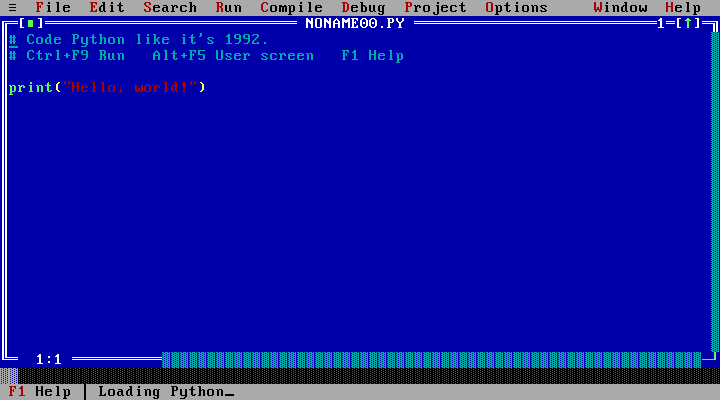

# PyTurbo

**Code Python like it's 1992.**

PyTurbo is a free, open-source Python IDE that aims to recreate the Turbo C++ 3.0
desktop in your browser: VGA colors, character-cell windows, menus, and F-keys.
Python runs locally in a Web Worker using Pyodide 314.0.7. The design needs no
application server or user account.

This is an early implementation of the [project plan](docs/project-plan.md), not a
finished v1 release. Exact visual fidelity, full browser compatibility, and
production readiness have **not** been certified. The Cloudflare Pages project
reserves `https://pyturbo.pages.dev`; its production deployment is still pending.
The [current branch preview](https://1f41908c.pyturbo.pages.dev) is deployed and has
passed runtime smoke checks. Initial Python loading depends on network speed;
one cold deployed test took about 72 seconds.
See [implementation status](docs/implementation-status.md) for verification limits.



This screenshot shows the current implementation. Original-IDE fidelity approval
and final icon design are still pending.

## Current implementation

The source includes an 80×25 canvas desktop, VGA cell engine and licensed font
atlas, eleven Turbo-style menus, movable editor windows, dialogs, syntax colors,
undo/redo, WordStar block commands, search, browser-local files, uploads/downloads,
and compressed share links.

Runtime code includes syntax checks, execution, stdout/stderr, live `input()`,
Stop/reset, arguments, project modules, package loading, and a Python shell.
Debugger, watches, evaluation, call stack, `conio`, BGI-style graphics, and a
canvas-backed `turtle` have implementations and browser coverage. Preferences,
fullscreen/touch controls, accessibility mirrors, and PWA caching also have
implementations. Source coverage is not a claim that every interaction has passed.

Component tests cover engine, editor, tokenizer, storage/share, and runtime
contracts. Browser checks exercise storage, synthetic IME, Python/CDN execution,
input/interrupts, debugging, packages, graphics and cached offline base-runtime
reload. Deployment, real OS clipboard/IME and device checks remain pending.
Full original-IDE comparisons and approved screen baselines are
pending; see [fidelity status](docs/fidelity-status.md).

## Run locally

Use Node.js 24 and pnpm 12.15.0. Dependencies are pinned in the lockfile.

```sh
pnpm install --frozen-lockfile
pnpm dev
```

Open Vite's printed URL. If pnpm is unavailable, substitute
`npx --yes pnpm@12.15.0 <command>` for `pnpm <command>`. Development and preview set
the COOP/COEP headers required by SharedArrayBuffer. The first Python load and
new package installation require network access.

```sh
pnpm lint
pnpm typecheck
pnpm test:coverage
pnpm build
pnpm exec playwright install
pnpm test:e2e
```

The browser suite targets Chromium, Firefox, and WebKit. WebKit testing does not
replace real Safari/iOS testing.

## Using the IDE

| Action                      | Shortcut          |
| --------------------------- | ----------------- |
| Run                         | Ctrl+F9           |
| Stop/reset                  | Ctrl+F2           |
| Check syntax / project      | Alt+F9 / F9       |
| Save / open                 | F2 / F3           |
| Help / menus                | F1 / F10          |
| User screen                 | Alt+F5            |
| Zoom / next window          | F5 / F6           |
| Trace / step / go to cursor | F7 / F8 / F4      |
| Breakpoint / add watch      | Ctrl+F8 / Ctrl+F7 |

Browser and OS shortcuts may be reserved. Use menus and available controls when
needed; fullscreen Keyboard Lock depends on browser support and permissions.
The agreed defaults are Exact 80×25, light-green identifiers, landscape phones with
touch controls, pause after run off, and browser-only execution. A finished run
returns to the IDE; Alt+F5 displays its output.

Files/settings belong to the current origin and browser profile. Download
important files separately because browser storage can be cleared. Share links
embed source in the URL fragment; anyone with the link can read it. Loading a
share does not automatically run or save the files. Inspect programs and packages
before running them; see [security](SECURITY.md).

Compatible Pyodide packages and pure-Python wheels are supported by the design.
Desktop-only native libraries, raw sockets, subprocesses, and arbitrary native
extensions remain outside its browser-only scope. Offline operation requires a
previously cached app/runtime/packages. Offline cold reload of the base interpreter
has passed automated checks; optional package caching still needs validation.

## Development and credits

The stack is TypeScript 7, Vite 8, Canvas 2D, Lezer Python, IndexedDB, lz-string,
Pyodide, and a PWA service worker. Intended hosting is Cloudflare Pages with GitHub
Actions and branch previews. Follow [CONTRIBUTING.md](CONTRIBUTING.md) and the
[accepted decisions](docs/decisions.md).

Application code is [MIT](LICENSE). The Px437 IBM VGA 9×16 font by VileR and its
derived atlas retain **CC BY-SA 4.0**, separately from the application license;
see [font provenance](public/fonts/README.md). Pyodide is MPL-2.0, Lezer Python and
lz-string are MIT, and idb-keyval 6.3.0 is Apache-2.0. The plan's MIT label for
idb-keyval was incorrect. See [NOTICE](NOTICE).

PyTurbo is an independent project, not affiliated with Borland or Embarcadero.
Turbo C++ is a trademark of its owner. No Borland binaries, code, logos, help text,
or screenshots are shipped.
