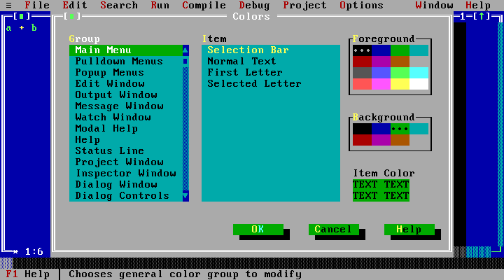
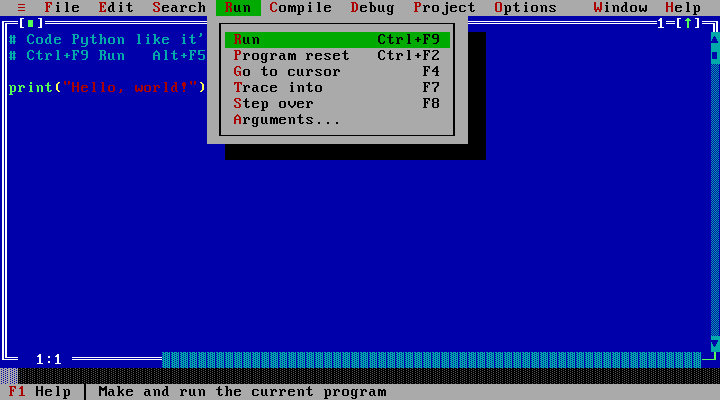

# Fidelity and Phase 0 verification

The implementation follows the agreed PyTurbo plan. Private original-IDE
captures now establish color attributes, the Colors group/item order and its
cell geometry. A complete pixel comparison is still pending. Passing unit tests
does not certify overall visual fidelity or complete Phase 0.

The [Phase 0 checklist](phase-zero-status.md) maps verified evidence and remaining
work to each foundation task and exit criterion. **Phase 0 is not complete.**

## Verified at the engine milestone

- `CellBuffer` stores Unicode glyphs and VGA attribute bytes in an explicit cell
  grid. Native canvas dimensions are 9×16 pixels per cell, giving 720×400 for
  80×25. Writes clip to the grid instead of spilling into adjacent rows.
- Unit tests cover frame geometry, clipping, source-character retention under
  `0x08` shadows, narrower shadows in 43/50-line mode, hardware palette indexes,
  all CP437 positions, and dispatch to the topmost eligible view. Nine engine
  unit tests passed locally on 26 October 2026.
- The 256-glyph atlas is generated directly from the licensed font outlines.
  Tests assert the one-pixel gap between double vertical bars and the ninth
  column rule for C0h–DFh. The full block occupies all 9×16 pixels.
- A local headless Chrome font probe measured 9px advance and a 16px full-block
  height at the native 16px size. It also exposed antialiasing that closed the
  gap in double vertical frames when alpha was thresholded at 128. CP437 now
  uses the deterministic prebuilt atlas, avoiding that browser rasterizer issue.
- The local font, full licence, pinned retrieval source, SHA-256 and atlas
  reproduction instructions are in `public/fonts/README.md`. Font and derived
  atlas remain CC BY-SA 4.0; application code remains MIT.

## Implemented foundations requiring integration validation

- Dirty-cell canvas repaint, previous-cursor restoration, underline/block
  cursors and palette-colour pixel output.
- View, Group, Window and Dialog rendering primitives, plus basic Label,
  Button, InputLine and ListBox drawing. These are building blocks; full control
  editing, focus navigation and Turbo dialog interaction require integration.
- The generic application/editor tables remain transcribed from the plan.
  IDE-specific defaults are now separately recorded in `src/ide/colors.ts`,
  following direct reference observation below. The selected-disabled factory
  color is now observed separately; customized behavior remains open in #45.
- COOP/COEP headers are configured in Vite development/preview and Pages
  `_headers`. The Pages preview response headers, CDN loading, live input,
  Stop and debugger checks pass; evidence is in `implementation-status.md`.
  Production and broader browser/device checks remain separate gates.

## Rendering corrections and automated shell checks, 27 October 2026

- Manual source scrolling now persists across cursor blinks. Caret visibility
  is adjusted by editing/navigation actions rather than by every repaint.
- Source layout, line offsets and semantic highlighting are cached until the
  source or relevant options change; repaint visits only visible source lines.
  This removes repeated whole-file parsing during idle cursor blinking. The
  plan's measured 60fps and load-time budgets still require profiling.
- Non-BMP characters occupy one rendered cell while editor offsets remain
  UTF-16. A browser regression checks the exact VGA bitmap immediately after an
  emoji and verifies pointer placement at the correct UTF-16 offset.
- Horizontal and vertical scrollbars now render a track/thumb from content
  extent. Help, Watch and Project rendering consumes per-window scroll and
  selection state. Monochrome suppresses window/menu/dialog/button shadows.
- Semantic token roles distinguish symbols from normal text even though both
  factory defaults are yellow. Changing a declared colour role now affects its
  rendered text, menu, status line, window or dialog instead of being lost in
  reverse lookup of an attribute byte.
- The initial eight shell cases passed in Chromium, Firefox and Playwright
  WebKit (**24 checks**): native 720×400 canvas and 16-colour output, integer
  2×/3× scaling, File/New before Python is ready, About hotkeys, modal focus,
  accessible-button Enter activation, wheel scrolling, phone alternatives and
  a structural axe scan. The UI tests deliberately hold Python loading;
  runtime execution is tested separately. Passing axe does not establish
  screen-reader or complete keyboard usability.
- Additional Chromium checks passed for exact non-BMP cell placement,
  independent symbol/menu customization through Colors, and suppression of
  dialog shadows in monochrome. Their final cross-browser results belong in
  the final validation record.
- Actual 80×25 File-menu and Open-dialog text/attribute fixtures are stored in
  `tests/unit/fixtures/golden/`. They are captured implementation contracts,
  clearly marked as unapproved for original-IDE fidelity. Native shell PNGs
  from Playwright are also evidence of current output, not approved references.

## Original Colors and window palettes, 27 October 2026

The owner authorized the reference emulator at [turboc.pages.dev](https://turboc.pages.dev)
and anonymous Playwright PNG captures. Captures remain in ignored local storage;
no reference screenshots, program or binaries are committed or shipped. Native
compositor captures were aligned to integer CSS coordinates to avoid fractional
cropping. Direct WebGL exports were blank and were not used as reference evidence.

- All **20 groups** were inspected, including the off-screen Dialog Messages,
  Buttons, Text Entry, Lists, Groups and Desktop Color entries. The selected
  item's `TEXT TEXT` sample establishes foreground/background bytes. Source
  transcription is separate from the generic Turbo Vision application palette.
- Output uses inactive title/border `07`, active title/border `0F`, icons `0A`.
  Message/Watch/Project/Inspector use inactive title/border `31`, marked text
  `2B`, active title/border `3F`, icons `3A`. Help uses normal text `30`, inactive
  title/border `30`, scrollbar `31`, and thumb/arrows `13`.
- The Colors dialog is 64×22 cells at `(8, 1)` in 80×25 mode, with separate
  Group and Item lists, 4×4 foreground and 4×2 background swatches, a sample,
  and OK/Cancel/Help. Long lists scroll independently. Accessible native controls
  mirror the canvas; edits preview in a draft, Cancel/Escape discard it, and OK
  persists it. Previously saved flat-role colors remain readable.
- Window titles, borders, icons, scrollbar track, thumb and arrows have distinct
  keys. Editing an editor role no longer changes unrelated window palettes.
  The original groups include roles for help links, modal help and other states
  that still need full UI implementations; those settings are retained without
  claiming those features are complete.
- The reference emulator produces **640×400, 8×16 cells**. Some glyphs differ
  from the licensed 9×16 font. The owner confirmed keeping **720×400, 9×16** on
  27 October. Cell geometry and palette verification do not establish equality
  between these different bitmap fonts or approve a complete visual baseline.

The original monochrome focus markers, complete control focus/pressed states,
dialog templates and narrow-screen usability still need reference and device
verification.

Local lint, typecheck, 48 unit tests and the production build pass. All 81
shell/editor browser cases pass across Chromium, Firefox and Playwright WebKit.
After the final picker-frame correction, all nine targeted Colors cases pass
again across those engines. The PR must also pass the complete runtime suite.

## Menu-bar row comparison

Independent pixel probes establish the first-glyph columns of the original
menu bar: System 2, File 5, Edit 11, Search 17, Run 25, Compile 30, Debug 39,
Project 46, Options 55, Window 66 and Help 74. The left captions, selection
regions and pointer targets now follow those cells. The System glyph uses the
hotkey color. Popup origins remain separate: File's outer blank column is 3,
its frame is at 4, and item text starts at 6.

The independently transcribed `menu-bar.cells.json` verifies that row's text and
VGA attributes. The earlier File-menu and Open-dialog whole-screen fixtures
remain implementation contracts. Neither the single row nor those fixtures
certifies all menus, glyphs, dialogs or original interaction behavior.

The correction passes local lint, strict typecheck, 50 unit tests and the
production build. Fifteen browser cases pass across the three engines for the
reference caption cells, File's pointer boundary, color preferences and native
720×400/2×/3× scaling. PR #28 then passed all 132 browser cases and other
required checks. Five production UI checks also passed after its deployment.

## Pull-down comparison, 29 October 2026

Private native captures establish the following zero-based top-border cells in
the original 80×25 grid. These are independent geometry facts, despite the
different 8×16 and approved 9×16 fonts.

| Menu    | Border columns | Width including the two outer blank columns |
| ------- | -------------- | ------------------------------------------- |
| Run     | 24–50          | 29 cells                                    |
| Compile | 29–54          | 28 cells                                    |
| Debug   | 38–70          | 35 cells                                    |

PR #47 (issue #46) uses those minimum widths, retaining dynamic expansion
for longer captions. Menu ellipses render as three CP437 period cells. Accessible
command names retain their existing labels. The File-menu implementation
snapshot changes only five caption rows; its attribute rows are unchanged.
Native-canvas tests check all three border spans, the three period bitmaps, and
pointer/keyboard activation at the corrected Run menu's right margin. After the
owner's go-ahead, all 267 browser CI cases and other required checks passed.
Nine Chromium smoke cases passed on the exact preview and again on production
after merge `60da202`. This correction is deployed.

The original captures show disabled entries as `78` when unselected and `08`
when selected, rather than the generic Turbo Vision `28`. Fresh reference
sessions initially failed in the site's Lexical text-input wrapper. On 30 October,
a private loader omitted that wrapper and ran the same unmodified DOS bundle;
the About dialog verified Turbo C++ 3.0, and the bundle hash is recorded in
`tests/unit/fixtures/golden/menu-disabled.colors.json`.

Controlled Color-mode probes changed Selection Bar from `20` to `51`, then in a
fresh session changed Disabled Entry from `78` to `59`. Enabled Arguments and
unselected disabled rows reflected those accepted values. Selected disabled Run
and Program reset remained `08` in every case. Lossless native-canvas pixel
histograms independently confirm the gray-on-black result; it is not a formula
derived from either editable role.

PR #50 (issue #45) uses `08` for selected disabled entries while retaining the separate
custom roles for enabled selections and unselected disabled entries. The generic
Turbo Vision table remains unchanged. The new reference-driven unit cases first
failed on the prior source. The owner confirmed the local highlight and disabled
Enter behavior. All 270 browser CI cases and other required checks passed;
10 Chromium checks passed on the exact preview and again on production after
merge `8f6f3e0`. The correction and illustrated manual are deployed. The measurements cover
Color mode only; original monochrome behavior is
not certified. No original images or emulator assets are shipped.

## Ready editor status row, 30 October 2026

The original new-editor and zoomed-editor captures establish the normal status
row at row 24. Key glyphs begin at zero-based columns 1 (F1), 10 (F2), 19 (F3),
28 (Alt-F9), 44 (F9) and 53 (F10). Their foreground is red `4`; Help, Save, Open,
Compile, Make and Menu captions use black `0`; the background is light gray `7`.
Blank-cell foreground follows the independently observed Status Line Normal Text
palette. Only these facts are committed in `status-line.cells.json`.

The new browser case compares all pixels of PyTurbo's row to those independent
cell facts rendered with the approved licensed 9×16 atlas. It checks the ready
editor, a changed menu hint, restoration after Escape and preserved source.
It passes in Chromium, Firefox and Playwright WebKit; CI and deployment evidence
is recorded in the PR validation record. This verifies the normal row within the chosen font; it does
not certify literal equality to the original 8×16 bitmap, menu/debugger hints,
other screen modes or the whole desktop.

The reference's newly opened editor had a shorter height before F5; its initial
configuration has not been independently established. That single state is not
treated as a factory default. Its zoomed frame
spans rows 1–23; initial-window geometry needs separate configuration evidence.

## Editor viewport navigation

Private original-IDE captures verify a one-row overlap: Page Down moves 13
lines in a 14-row text body, then 6 lines after resizing to 7 visible rows.
Ctrl+C follows the same paging rule. The first visible line moves with the
caret, keeping its screen row. Ctrl+Home/End and Ctrl+Q E/X select the first/last
visible line; separate column probes confirm that the source column is retained.
Only behavior facts are committed, in `tests/unit/fixtures/editor-navigation.json`.
The first fast capture dropped input and is excluded from this evidence.

The editor uses the host's current body height for these commands, including
resized and zoomed windows, 43/50-line and Fill layouts. Page selections and
preferred columns through shorter lines are covered separately. This establishes
these commands' semantics, not physical browser/OS shortcut capture. The later
Ctrl+O F/R work is recorded below. PR #30 passed all 144 browser cases, the
other required checks and its preview. All five production navigation cases pass.

Private Editor Options captures and a separate Backspace probe confirm the
implemented Ctrl+O T/U meanings: true-tab insertion and leading-whitespace removal
to a preceding smaller indentation. A 7-column indent returns to a prior 3-column
indent; with Unindents off, Backspace removes one character. These options and
Ctrl+O I use the dialog's shared persistent settings, as observed across newly
created reference editors. Issue #33 adds Optimal Fill and cursor-inside-tab
editing. Private probes establish tab-cell navigation, vertical snapping with
Through Tabs off, insertion with a retained hard-tab remainder, Backspace/Delete,
newline handling and source-anchored legacy block boundaries. The implementation
and tests record those observations independently; they do not certify complete
editor fidelity. CUA partial selections, clipboard representation and native IME
retain the verification limits in [editor-and-storage.md](editor-and-storage.md).

## Reference comparison still required

Capture original IDE screens privately; the plan excludes Borland screenshots
from the repository and shipped assets. Compare the following at native size,
then verify integer 2× and 3× rendering:

- Main desktop, menu bar, status line, active/inactive editor frames.
- Every pull-down menu and submenu, including disabled selections and shadows.
- Open, About, Colors and Compiling dialogs and each control focus state.
- Message/Watch/Output windows, source tracking and debugger execution bars.
- 25/43/50-line modes, fit modes, modified indicator and all scrollbar states.

Current golden unit assertions include small geometry fixtures and captured
80×25 shell cell contracts. They are not owner-approved full-screen baselines
transcribed from the original IDE.

## Keyboard capture matrix

The matrix remains incomplete. Partial native Chrome/Windows observations are
recorded in the [Phase 0 checklist](phase-zero-status.md#native-chrome-spot-checks-29-october-2026);
the installed browser version and remaining keys still need verification.
Calling `preventDefault()` in
the application does not establish that a browser or OS reserved key was
captured. Playwright WebKit also does not establish behaviour on real Safari or
iOS. Menus and visible controls must remain usable for unavailable shortcuts.
The owner approved continuing implementation with these real-device gates open.

| Key group                                  | Chrome/Windows                               | Edge/Windows                     | Firefox/Windows       | Safari/macOS          | Safari/iOS                    |
| ------------------------------------------ | -------------------------------------------- | -------------------------------- | --------------------- | --------------------- | ----------------------------- |
| F1/F3/F5/F6/F10/F11                        | First five observed; F11 pending             | Pending                          | Pending               | Pending               | No physical F-keys by default |
| Alt+letter menus, Alt+F1/F3/F4/F5/F7/F8/F9 | Alt+R observed; Alt+C conflict; rest pending | Pending                          | Pending               | Pending               | Pending hardware keyboard     |
| Ctrl+F1–F9, Ctrl+W/T/N/Tab                 | Ctrl+T opened browser tab; rest pending      | Pending                          | Pending               | Pending               | Pending hardware keyboard     |
| Ctrl+K/Q WordStar sequences                | Pending                                      | Pending                          | Pending               | Pending               | Pending hardware keyboard     |
| Clipboard and IME                          | Pending                                      | Pending                          | Pending               | Pending               | Pending                       |
| Fullscreen Keyboard Lock                   | Pending support/permission check             | Pending support/permission check | Pending support check | Pending support check | Pending support check         |

Real Android Chrome, phone landscape layout, touch controls, screen readers,
performance budgets and offline runtime/package behaviour remain separate
verification tasks. Characters outside CP437 currently use a single-cell
browser-font fallback, which has no VGA fidelity guarantee.
