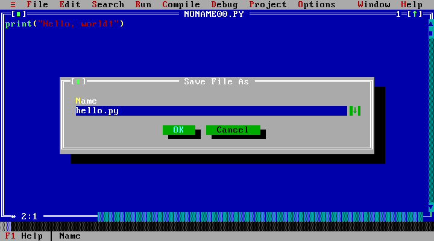

# 2. Editing and files

[← First program](getting-started.md) · [Manual contents](README.md) ·
[Next: Running and debugging →](running-and-debugging.md)

## Everyday editing

Click a text position to move the caret. Use the arrow keys to move and
**Shift+movement** or a mouse drag to select text. **Insert** switches between
insertion and overwrite. Undo is **Alt+Backspace** or **Ctrl+Z** with the default
CUA keys enabled; redo is **Shift+Alt+Backspace** or **Ctrl+Shift+Z**.

By default, **Tab** inserts spaces to the next four-column tab stop.
**Shift+Tab** unindents. Enter copies the line’s indentation and adds a level
after a colon. Use **Options → Environment → Editor…** to change these options.
Mixing hard tabs and spaces can produce Python indentation errors.

Clipboard commands are in **Edit**. Standard Ctrl+C/X/V shortcuts are enabled
by default. A browser can reserve a shortcut or require clipboard permission;
use the menus when a shortcut is unavailable.

## Move, search, and replace

| Task                           | How                                                        |
| ------------------------------ | ---------------------------------------------------------- |
| Beginning/end of line          | Home / End                                                 |
| Beginning/end of file          | Ctrl+Page Up / Ctrl+Page Down                              |
| Page through the source        | Page Up / Page Down; the next page overlaps by one line    |
| First/last visible editor line | Ctrl+Home / Ctrl+End                                       |
| Find text                      | Search → Find…                                             |
| Replace text                   | Search → Replace…                                          |
| Repeat the last search         | Ctrl+L or Search → Search again                            |
| Move to a line                 | Search → Go to line number…; enter a one-based line number |
| Find a definition              | Search → Locate function…                                  |

Ctrl+Home/End follow the Turbo-style viewport commands. Use Ctrl+Page Up/Down
for file boundaries. Search and replace are literal text operations rather than
regular-expression search.

## New, open, and save

- **File → New** creates another editor window.
- **F3 / File → Open…** opens a file saved in the browser workspace. It is not
  the operating system’s file picker.
- **File → Upload…** imports `.py` files from your computer into open editors.
  Save them to keep them in this workspace. An already-open name asks before
  replacing its source.
- **F2 / File → Save** saves the active editor using its current name.
- **File → Save as…** saves under another relative project name. Names such as
  `helpers.py` or `tools/helpers.py` are valid; Windows drive paths are not.
- **File → Save all** saves the open editor files.
- **File → Download .py** downloads a separate copy of the active program.

A `*` in the editor frame marks unsaved changes. Closing a modified editor asks
whether to save, discard, or cancel. A failed save leaves the source available
and reports an error. Edits made while a save is completing still need saving.

Enter a project filename in **Name**, then choose OK. This saves in the browser
workspace; use Download .py for a separate file on your computer.

## Where files live

Saved files, preferences, and editor-window positions belong to the current
**origin and browser profile**. For example, the public site, a PR preview,
`127.0.0.1:4175`, another local port, and another browser have separate workspaces.
File → Change dir shows the virtual project directory; it does not browse your
computer’s disk.

Download files you want to keep separately. Browser site-data cleanup, private
browsing, or storage limits can remove or prevent browser saves. PyTurbo does
not currently synchronize files with a GitHub account or a cloud drive.

## Multiple files and windows

Each source file has an editor window. Use **F6** for the next window,
**Alt+0 / Window → List all…** to select one, **F5** to zoom/unzoom, and
**Window → Tile** or **Cascade** to arrange them. **Alt+F3** closes the active
window.

Run the desired main file from its editor. Other project files are available
for Python imports. If Output or Help is active, Run uses the most recently
active editor. See the [two-file example](examples.md#two-file-program).

Project → Open project opens the saved workspace files; it does not open an
arbitrary desktop folder. Project → Add item uses file upload. Deleting a project
item removes that saved workspace item after the confirmation shown by the IDE;
download important files before deleting them.

## Share source

Choose **File → Share link…**. The link contains compressed project source in
its URL fragment. Anyone with the link can read that source. Opening a share
loads source into memory without automatically saving or running it.

Do not include private data in programs you share. Large projects can exceed
the share size limit; download their files instead.

## WordStar sequences

These are two-step sequences: press **Ctrl+K**, release it, then press the
second key. You do not have to keep Ctrl held for the second key.

| Sequence          | Action                                                 |
| ----------------- | ------------------------------------------------------ |
| Ctrl+K, B / K     | Mark the beginning / end of a block                    |
| Ctrl+K, C / V / Y | Copy / move / delete that block                        |
| Ctrl+K, I / U     | Indent / unindent selected lines                       |
| Ctrl+K, H         | Hide/show the marked block                             |
| Ctrl+K, 0–9       | Set a bookmark                                         |
| Ctrl+Q, 0–9       | Jump to a bookmark                                     |
| Ctrl+Q, F / A     | Find / replace                                         |
| Ctrl+O, I / T / U | Toggle auto-indent / literal Tab / Backspace Unindents |

The [developer editor notes](../editor-and-storage.md) describe additional
legacy sequences and their limitations. Optimal Fill and Cursor Through Tabs
are still pending; an accepted default is not a shipped option.

**Next:** [Running and debugging →](running-and-debugging.md)
