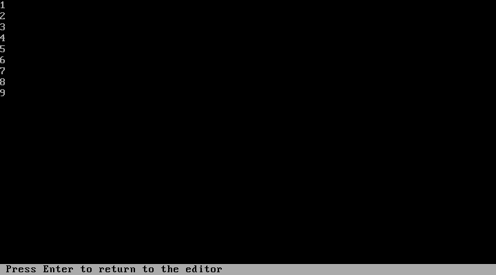

# 6. Examples to try

[← Settings and troubleshooting](settings-and-troubleshooting.md) · [Manual contents](README.md)

For each example, put the source in an editor and press **Ctrl+F9**. To leave
results visible, enable [Pause after run](getting-started.md#keep-output-visible).
A new run clears the last output.

## Numbers from one to nine

```python
for number in range(1, 10):
    print(number)
```

The output is 1 through 9, one number per line. `range(1, 10)` stops before 10.
Run it twice: the second result replaces the first; the pause footer does not
become another output line.



Only the numbers are program output. The gray bottom row is PyTurbo’s pause
instruction; press Enter when you want to return to the editor.

## Ask a question

```python
name = input("Name: ")
age = int(input("Age: "))
print(f"Hello, {name}. Next year you will be {age + 1}.")
```

Enter each answer on the output screen. With prefilled-input fallback, use
`Ada|21`; the last line is `Hello, Ada. Next year you will be 22.`
An answer that is not an integer produces a `ValueError` at the conversion line.

## Two-file program

Create these two files with **File → New** and **Save as…**.

`greetings.py`:

```python
def greet(name):
    return f"Hello, {name}!"
```

`main.py`:

```python
from greetings import greet

print(greet("Ada"))
```

Activate the `main.py` editor using F6 or Window → List all, then run. The
result is `Hello, Ada!`. Change the helper and run the main editor again to use
the updated source.

## Inspect a variable

```python
total = 0
for number in range(1, 4):
    total += number
print("total", total)
```

Place the caret on `total += number` and press **Ctrl+F8** to set a breakpoint.
Run with Ctrl+F9, then inspect `total` and `number` while paused. Step with F7/F8
or resume with Ctrl+F9. The finished program prints `total 6`.
Remove the breakpoint with Ctrl+F8 when you are done.

## Program arguments

Set **Run → Arguments…** to `alpha|two words|3`, then run:

```python
import sys

print(sys.argv[1:])
```

The output is `['alpha', 'two words', '3']`. Clear the Arguments field when
you no longer want these arguments for subsequent runs.

## Plot with NumPy and Matplotlib

This example needs compatible packages and network access on their first load.

```python
import numpy as np
import matplotlib.pyplot as plt

x = np.arange(4)
print("sum", x.sum())
plt.plot(x, x * x)
plt.title("Squares")
```

It prints `sum 6` and creates a plot. If execution returns to the editor,
Alt+F5 displays the User Screen and its plot. Plots are separate graphics output,
not characters drawn into the text-output log.

## A single key with conio

```python
import conio

conio.clrscr()
print("Press a letter")
key = conio.getch()
print("You pressed", key)
```

`getch()` consumes one key without needing Enter. That is program input, distinct
from the IDE’s Enter-only return after completion. `conio.clrscr()` can clear text
partway through a program; automatic clearing happens before a new run.
Live single-key input requires cross-origin isolation.

## Draw with turtle

```python
from turtle import forward, left, pencolor

pencolor("red")
for side in range(4):
    forward(60)
    left(90)
input("Press Enter when finished viewing: ")
```

This uses PyTurbo’s canvas-backed turtle subset. It is not a complete desktop
Tkinter turtle environment. The `input()` keeps the running program visible;
with prefilled stdin, use Pause after run to keep completed output visible.

**Continue exploring:** [Menu and shortcut reference](menus-and-shortcuts.md) ·
[Troubleshooting](settings-and-troubleshooting.md)
