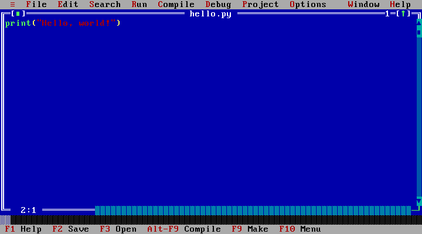
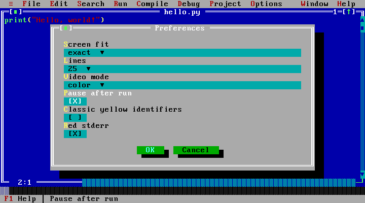

# 1. Your first program

[Manual contents](README.md) · [Next: Editing and files →](editing-and-files.md)

## Open the desktop

1. Open [pyturbo.pages.dev](https://pyturbo.pages.dev).
2. Wait for Python to finish loading. The first visit downloads the interpreter;
   you can edit while it loads.
3. Click inside the blue editor. A new file has a name such as `NONAME00.PY`.

The gray top row contains menus. The blue window holds your source code. Its
bottom edge shows the cursor’s line and column. The bottom status row shows
useful keys. On smaller screens, buttons provide Run, Stop, Save, Open, Menu,
User screen, Trace, Step, and DOS mode actions.



The filename is at the top of the editor frame; source goes in the blue area.

## Write and run

Replace the starter program with:

```python
print("Hello, world!")
```

Press **Ctrl+F9**, or choose **Run → Run**. Python executes the current editor’s
program. After it finishes, the default behavior returns to the blue editor.

Press **Alt+F5**, choose **Window → User screen**, or use the **User screen**
button to read the result:

```text
Hello, world!
```

Press **Enter** to return from completed output to the editor. This key returns
you to editing; it does not run the program again.

## Keep output visible

For learning or taking screenshots, turn on the optional pause:

1. Open **Options → Environment → Preferences…**.
2. Check **Pause after run**.
3. Choose **OK**.
4. Run the program again with **Ctrl+F9**.



`[X]` means **Pause after run** is enabled. Choose OK to save the setting.

The output remains visible after completion. A separate gray footer says
**Press Enter to return to the editor**. That footer belongs to the IDE; it is
not text printed by your program. Letter keys, clicks, and modifier keys do not
dismiss completed output.

Every new program run clears the previous result. You see the latest run rather
than several runs joined together. Returning to the editor does not itself erase
the result: **Alt+F5** can display it again until a new run starts.

Pause after run is off in the factory settings. Your choice is saved for the
current browser workspace.

## Save your program

Choose **File → Save as…**, enter `hello.py`, and choose **OK**. Later, **F2**
saves that file in PyTurbo’s browser workspace. Use **File → Download .py** to
keep a separate copy on your computer.

Saving in the browser and downloading a file are different actions. Switching
browsers, browser profiles, or between the public site and a local preview does
not transfer that workspace. See [where files live](editing-and-files.md#where-files-live).

## Try changing it

```python
name = input("Your name: ")
print("Hello,", name)
```

Run it, type your name on the output screen, and press **Enter** to submit the
input. While a program is asking a question, Enter submits your answer. After
the program finishes, Enter returns to the editor.

**Next:** [Editing and files →](editing-and-files.md)
