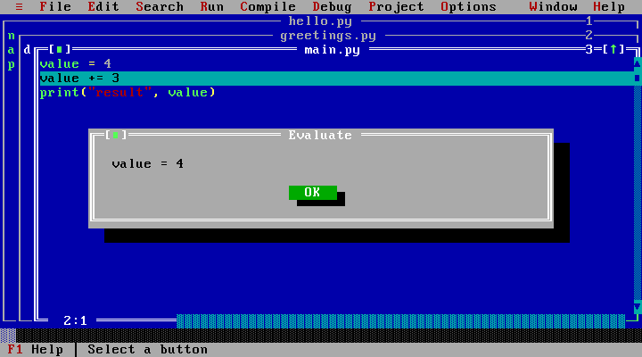

# 3. Running and debugging

[← Editing and files](editing-and-files.md) · [Manual contents](README.md) ·
[Next: Menus and shortcuts →](menus-and-shortcuts.md)

## Run and read the result

**Ctrl+F9 / Run → Run** checks and executes the selected program. Run saves the
open editor files first. A syntax-check failure opens messages instead of
starting the program; fix the reported file and line, then run again.

During execution, stdout and stderr appear on the black User Screen. On
completion, PyTurbo returns to the editor unless **Pause after run** is enabled
under **Options → Environment → Preferences…**. **Alt+F5** displays the last
output; **Window → Output** opens it in a smaller window.

- Each new program run clears previous output. Earlier runs are not a history
  you can select later.
- Enter returns from completed output. Other ordinary keys and clicks leave it
  visible. Menu commands and User screen controls can still switch views.
- A pause instruction appears in a separate gray footer. It is not part of
  your program’s output.
- Returning to the editor does not clear the result. A new run does.
- Debugger steps, resume, and multiple input requests belong to the same run;
  they retain that run’s output.

Copy or capture a result before starting another run if you want to compare it.
For a screenshot on Windows, leave the output visible and use **Windows+Shift+S**.
The IDE ignores those system keys. Actual OS shortcut behavior still depends on
the browser and device; see [screenshot troubleshooting](settings-and-troubleshooting.md#take-a-screenshot-of-output).

## Input, stopping, and reset

For ordinary `input()`, type on the output screen and press Enter. Do not
press Run again to submit an answer. The program continues until its next
question or completion.

Live input and debugging need the site’s COOP/COEP isolation headers. If live
input is unavailable, Run opens a **Program input** dialog. Enter answers in
order, separated by `|`, such as `Ada|21`. That fallback supplies input before
execution; it is not an interactive terminal.

Use the **Stop** button to interrupt a running program, including a program
waiting for input. **Ctrl+F2 / Run → Program reset** restarts Python when you
need to reset the interpreter. Your editor source remains available. After the
runtime is ready again, you can run another program.

Normal program runs start with fresh main-module globals. For example, a
variable created by the last run is not an input to the next run. The Python
shell behaves differently: it keeps its names between shell commands.

## Syntax checks and errors

**Alt+F9 / Compile → Compile** checks syntax. **F9 / Compile → Make** checks
the project. These commands do not create a Windows `.exe`; this is a Python
environment.

Syntax errors and runtime tracebacks identify a filename and line. Use the
Message window, **Alt+F7 / Alt+F8** for previous/next error, or Search → Go to
line number to inspect the source. A runtime error can leave a traceback in
the last output even after the editor is visible.

## Program arguments and project imports

Open **Run → Arguments…** and separate arguments with `|`.
`alpha|two words|3` supplies three strings after `sys.argv[0]`.

Save helper source files using names that match their imports, then run the
main editor. Python can import those project files. See
[examples](examples.md#two-file-program). A project file named after a standard
library module can shadow it; choose distinctive helper names.

## A short debugger walkthrough

Put this program in an editor:

```python
value = 4
value += 3
print("result", value)
```

1. Press **F7** to start tracing. The highlighted execution line identifies
   where Python is paused.
2. Press **F7** again to execute a line and pause at the next trace point.
3. Press **Ctrl+F4 / Debug → Evaluate/modify…**. Evaluate `value` while it is
   in scope. Leave **Execute statement (modify)** off when you only want to
   inspect an expression.
4. Close the result dialog. Press **Ctrl+F9** to resume.
5. View `result 7` on the User Screen.



The highlighted source line is the pause location. The result dialog shows the
value before `value += 3` executes; resume to reach the final result of 7.

| Debug action                     | Key / menu           |
| -------------------------------- | -------------------- |
| Trace into calls                 | F7                   |
| Step over a line                 | F8                   |
| Run to the caret’s line          | F4                   |
| Toggle a breakpoint at the caret | Ctrl+F8              |
| List breakpoints                 | Debug → Breakpoints… |
| Add a watch expression           | Ctrl+F7              |
| Inspect an expression            | Debug → Inspect…     |
| Evaluate or execute a statement  | Ctrl+F4              |
| View paused call stack           | Ctrl+F3              |
| Resume execution                 | Ctrl+F9              |

Pause before inspecting locals or the call stack. A variable may not yet
exist before its assignment has executed. Watches display expressions in the
current paused context. Native-extension internals do not provide the same
Python line-by-line stepping experience.

## Shell and packages

**≡ → Python shell (REPL)**, also reached by File → DOS shell, opens a Python
shell rather than Windows Command Prompt. Try `answer = 6`, then `answer * 7`.
Enter submits a command; Escape leaves the shell.

Imports can load compatible built-in Pyodide packages. Use **≡ → Package
manager (pip)…** for compatible pure-Python wheels, for example
`pyfiglet==1.0.4`. Packages are fetched from the network and execute code in
your browser. Desktop-only binary extensions, subprocesses, and arbitrary
native applications are unavailable.

**Next:** [Menus and shortcuts →](menus-and-shortcuts.md)
